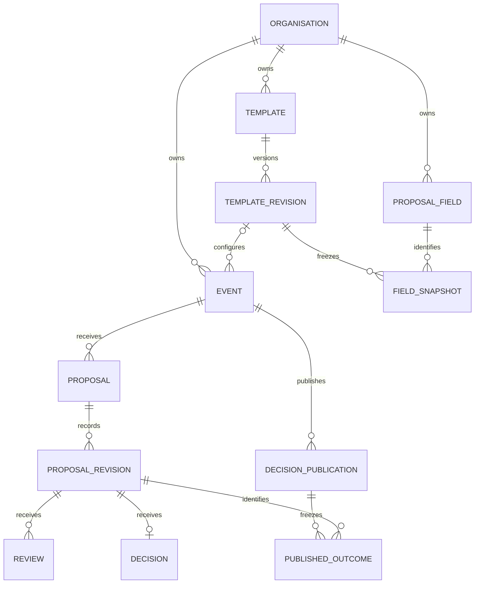

# Model and control plane contract

This v0 draft is for team review. It describes one CFP from reusable form
configuration through submission, review, decision publication and export.
The API shapes, lifecycle rules and permission names below are proposals.
GongHaa currently implements `GET /readyz` on both deployments.

## Design requirements

- Provide one versioned HTTP contract for Cloudflare Workers with D1 and
  independent Docker with PostgreSQL. Installers provision infrastructure and
  migrate the database. IaC clients apply application configuration over HTTP.
- Use SQLModel for persistence records and Pydantic for HTTP models. Keep
  database access behind the deployment adapters and share validation and
  lifecycle rules across both deployments.
- Give IaC-managed resources predictable keys and URNs. Support exact lookup
  and conditional writes so clients can detect and reconcile drift.
- Use social OIDC login for people and service principals for automation.
  Authorisation flows from a policy through a role to a scoped grant.

## Relationship map

The map shows resource relationships. Field snapshots can live in the
template revision, and exports can be generated from a publication.



- **Organisation and event.** The organisation owns reusable definitions and
  access configuration. An event selects a published template revision. Opening
  the CFP pins that revision for the event. The first flow is
  `draft → open → closed`.
- **Field and template.** A field defines a reusable input. A published
  template revision stores ordered field snapshots with their URN, label,
  kind, required flag and validation rules. Editing the field or publishing
  another template revision leaves earlier snapshots intact.
- **Proposal and revision.** A proposal belongs to its author and event. The
  author edits a draft until submission, which freezes a revision for review.
  Draft saves and submissions require an open CFP. The proposal uses its
  event's pinned template revision. Reopening or resubmitting a proposal is
  an open design choice.
- **Review and decision.** A review targets a submitted proposal revision and
  records its reviewer, rating and notes. One reviewer has one review per
  revision. The organiser can record or revise `accepted` or `rejected` while
  the outcome is staged.
- **Publication and export.** Publishing copies the event's staged decisions
  into an immutable snapshot and makes it current in the same transaction.
  Applicants see their own outcomes in the current snapshot. Later edits
  remain staged until the next explicit publication. An authorised organiser
  can export any specified publication and get the original outcomes.
  The export format and a public programme view are open design choices.

## Resource identity and HTTP

The proposed organisation and resource keys are lowercase, hyphen-separated
slugs. A proposal field URN is derived from its organisation and field key.
GongHaa resolves these identifiers within one installation. An IaC client
keeps the API endpoint together with the URN in its state.

```text
urn:gonghaa:org:pyconhk:proposal-field:talk-title
```

All organisation resources below are relative to `/v1/orgs/{org}`. Field
configuration is the first implementation slice. Later route names illustrate
the resource boundaries and are still open for review.

| Resource | Collection or action |
| -------- | -------------------- |
| Reusable field | `/proposal-fields` |
| Template revision | `/templates/{template}/revisions/{revision}` |
| Event and CFP state | `/events/{event}` |
| Proposal | `/events/{event}/proposals` |
| Submit a proposal | `POST` to a proposal's `/submit` action |
| Review and staged decision | A proposal's `/reviews` and `/decision` |
| Decision publication and export | An event's `/publications` and `/exports` |

### Field configuration

The canonical field route is `/proposal-fields/{key}`. Its writable JSON
properties start with `label` and `kind`, with `short_text` as the first kind.
The response includes the derived `urn`.

- `GET` the field to read it with its `ETag`, or receive `404`.
- `GET /proposal-fields?urn={urn}` returns an `items` list containing the
  exact authorised match, or an empty list. Clients URL-encode the URN.
- `PUT` with `If-None-Match: *` creates the field and returns `201` with its
  `Location`. An existing field returns `412`.
- `PUT` with `If-Match: <etag>` applies to the matching revision and returns
  `204`. The server preserves the revision when the normalised values match.
  A stale revision returns `412` and a missing precondition returns `428`.

The database checks the revision and writes atomically. A client reads the
canonical resource after a successful write to get the new `ETag`. After a
lost response or `412`, it reads the current state and compares it with the
desired state before retrying. [HTTP PUT and preconditions][rfc9110-put] ·
[Precondition Required][rfc6585]

For later mutations, use `409` for an action that conflicts with the resource
state, such as submitting to a closed event. Use `422` for a payload that
fails validation. Return a stable machine-readable error code. Use `401` for
missing or invalid authentication and `403` for missing permission within an
organisation the caller can access. Resolve out-of-scope resources as `404`.
Proposal and publication creation must specify retry behaviour before their
routes are frozen.

## Principals and permission checks

OIDC maps the validated `(issuer, subject)` pair to a GongHaa user. Access is
evaluated for that local user. Service principals have separate credentials
and grants for IaC. Credential bootstrap, rotation and revocation still need
a concrete operator design. [OIDC identifier stability][oidc]

1. A **policy** permits actions on named resource types or identities.
2. A **role** groups policies.
3. A **grant** assigns one role to a principal for an organisation or a
   particular event.

Each protected call requires a matching action, resource and grant scope. An
event grant covers only that event. The proposed public CFP flow provisions a
configured applicant role grant for a signed-in user when they start a draft
in an open event. The role permits creating a proposal and managing or
reading the applicant's own records. An organiser needs export permission to
retrieve a complete publication.

For IaC, `proposal-field:read` on one organisation permits a field lookup
there. `proposal-field:write` is a separate permission.

## End-to-end acceptance

Use the same public HTTP scenarios against the built Worker in Workerd with
local D1 and the Docker image with PostgreSQL. Pytest fixtures own setup and
cleanup. Tests show each API call and assertion in order.

1. **Apply a field.** Create it conditionally, resolve its URN, reapply the
   same body with the current `ETag`, and verify the revision stays stable.
   Apply a change, then verify a stale write returns `412`. A read-only
   principal succeeds on lookup and receives `403` on write.
2. **Keep a form stable.** Open a CFP with template revision 1 and create a
   proposal. Publish revision 2 and verify that changing the open event's
   pinned revision returns `409`. Read and submit the proposal using revision
   1. A new event can select revision 2. Closing the first CFP makes a new
   submission return `409`.
3. **Review and publish.** An authorised reviewer saves a review against the
   submitted revision. An organiser records a decision. The applicant sees
   it only after publication, and another applicant cannot read it. The
   organiser export matches the frozen publication.

## Terraform boundaries

Infrastructure and CFP configuration have separate lifecycles. Preserve the
same application contract whichever deployment an organiser chooses.

- **Cloudflare infrastructure.** Terraform can manage the D1 database,
  Worker, bindings, immutable Worker version and traffic deployment. A
  release builds the Python modules and dependencies with Pywrangler first.
  Terraform then uploads the built modules. Another supported option is for
  Terraform to own the infrastructure and for Wrangler to own Worker versions
  and deployments. Choose one owner for each resource. [Cloudflare IaC][cf-iac]
- **Self-hosted infrastructure.** Build the Docker image from source, provision
  PostgreSQL and run its migrations. Operators can use their existing Docker
  or Kubernetes tooling for deployment. The self-hosted application serves
  the same API independently of Cloudflare.
- **GongHaa configuration.** Apply application resources once the database
  schema and API are ready. A future Terraform provider would resolve and
  import a field by URN, read state and its `ETag` for drift detection, and
  apply changes with the documented preconditions. Decide how to archive
  resources that published templates still reference before supporting
  Terraform destroy for those resources.

A local Terraform `validate` passed with Cloudflare provider `5.29.0` for a
D1 database, a Python Worker version with two modules and the `D1` binding,
and a deployment to that version. The hosted PoC must upload the complete
Pywrangler artifact, apply D1 migrations, check `/readyz` and repeat the apply.
It should prove that an unchanged plan is empty and that a code-only update
creates a new Worker version while keeping the same database.

## Worker and D1 proof of concept

Local readiness runs in GongHaa CI on both deployments. A separate prototype
ran three HTTP cases against the bundled Python Worker and local D1.

- Conditional create, URN lookup and an unchanged apply behaved as specified.
- Two simultaneous writes with the same `ETag` returned one `204` and one
  `412`. The winning value was readable afterwards.
- An induced SQLite constraint failure rolled back the update and preserved
  both the old value and its `ETag`.
- A separate Pywrangler bundle imported SQLModel `0.0.50`, SQLAlchemy `2.1.9`
  and Pydantic `2.14.3`. A real HTTP request exercised a SQLModel table
  definition and SQLite DDL generation. An invalid request returned `422`.

The Worker can use the shared model types and execute D1 queries through its
native binding. The PoCs do not establish a D1-backed SQLAlchemy session.
The full contract and hosted capacity still need these checks.

- Do equivalent migrations create the same constraints on D1 and PostgreSQL?
  Exercise a clean schema and an upgrade with existing records.
- Prove cross-runtime parity for conditional writes. Test publication and
  rollback through D1's native binding and PostgreSQL transactions. A stale
  `UPDATE` can affect zero rows without raising a SQL error. Dependent audit
  or publication writes must be conditional on a change. [D1 binding API][d1]
- Can the real Worker complete a configured OIDC login and preserve sessions
  across requests? Exercise denied grants alongside successful login.
- Repeat the critical paths on an isolated hosted Worker and D1 database.
  Measure bundle startup, request CPU, database I/O, export and deadline bursts
  under the scenarios in the [hosting cost model](hosting-cost.md).
  [Python Workers packages][worker-packages]

Before freezing v0, agree on the exact URN vocabulary, field changes that
require a new key, credential bootstrap and publication/export semantics.
Define the separate programme snapshot, change feed and webhook delivery
contract with the website integration when its consumers are in scope.

[rfc9110-put]: https://www.rfc-editor.org/rfc/rfc9110.html#section-9.3.4
[rfc6585]: https://www.rfc-editor.org/rfc/rfc6585.html#section-3
[oidc]: https://openid.net/specs/openid-connect-core-1_0.html#ClaimStability
[worker-packages]: https://developers.cloudflare.com/workers/languages/python/packages/
[d1]: https://developers.cloudflare.com/d1/worker-api/d1-database/
[cf-iac]: https://developers.cloudflare.com/workers/platform/infrastructure-as-code/#terraform
